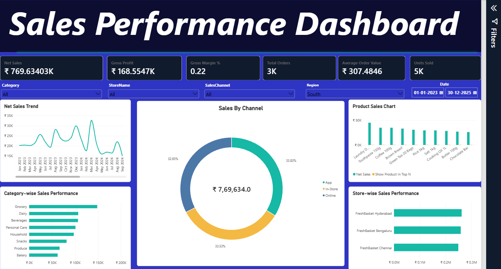
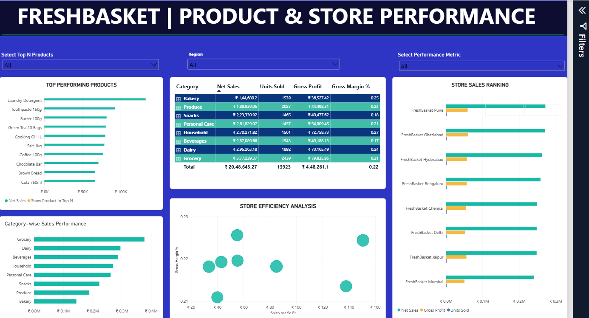
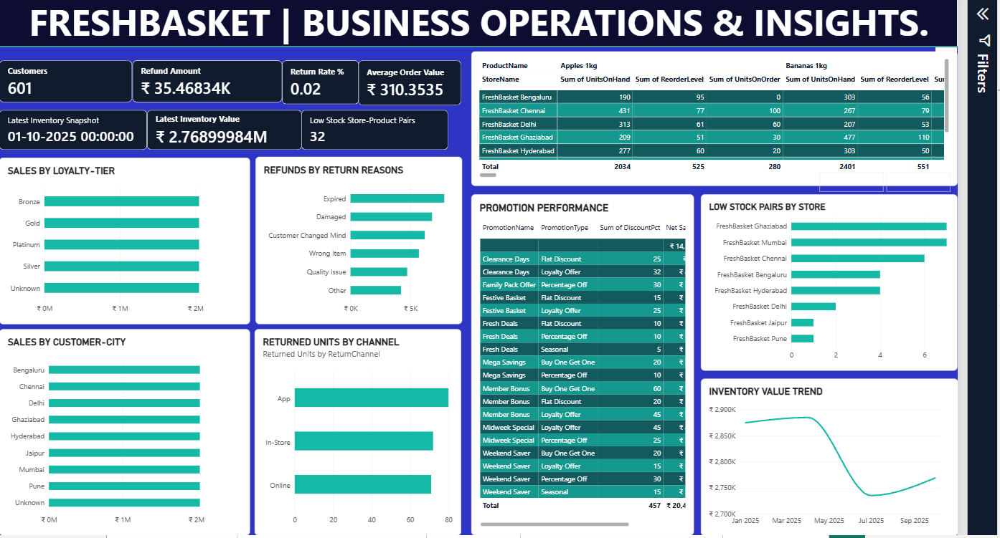

# FreshBasket — Supermarket Sales Analytics Dashboard

An end-to-end **Power BI data analytics project** built around a fictional supermarket chain. The project demonstrates data preparation, ETL, relational data modelling, DAX measures, interactive reporting and business-focused analysis.

> **Data disclaimer:** All records and business results in this project are synthetic and created for learning and portfolio demonstration. They do not represent a real supermarket or actual financial performance.

## Project overview

FreshBasket analyses sales, products, stores, customers, promotions, returns and inventory. The source dataset contains **8 related tables** and **9,027 raw records**. The Sales table contains 7,008 raw rows; after removing 8 duplicate transaction IDs, it contains 7,000 cleaned rows.

**Tools:** Microsoft Power BI · Power Query (M) · DAX · Excel

## What I implemented

- **ETL and data cleaning:** parsed mixed date formats, removed duplicate transaction IDs, standardized IDs and text, converted data types, and handled missing values without inventing missing quantities.
- **Data modelling:** created a relational, star-schema-style model with dimension and fact tables, one-to-many relationships, and a dedicated Date table.
- **DAX analytics:** created measures for Net Sales, Gross Profit, Gross Margin %, Average Order Value, Orders, Units Sold, sales growth, returns and inventory performance.
- **Advanced analysis:** implemented Top N product analysis, what-if sales target and discount scenarios, a metric selector, conditional formatting, bookmarks and drill-through.
- **Interactive reporting:** built KPI cards, trend analysis, category/store/channel comparisons, slicers and detailed drill-through views.

## Report pages

1. **Executive Overview** — headline KPIs, sales trend, store and category performance, and sales-channel mix.
2. **Product & Store Performance** — Top N products, category/product matrix, store ranking and store-efficiency comparison.
3. **Business Operations & Insights** — customer, promotion, returns and inventory analysis.
4. **Store Detail (drill-through)** — store-level KPIs and performance trends.
5. **Product Detail (drill-through)** — product-level KPIs, sales trend and brand comparison.

<!-- Add screenshots to the Screenshots folder, then uncomment these lines.
## Dashboard preview



-->

## Data quality and transformation summary

| Table | Raw rows | Clean rows |
|---|---:|---:|
| Sales | 7,008 | 7,000 |
| Products | 46 | 46 |
| Customers | 600 | 600 |
| Stores | 8 | 8 |
| Employees | 40 | 40 |
| Promotions | 25 | 25 |
| Returns | 180 | 180 |
| InventorySnapshots | 1,120 | 1,120 |

Key decisions: slash-formatted dates were parsed as `dd/MM/yyyy`; duplicate Sales transaction IDs were removed; missing quantity and customer IDs were retained as blanks; missing customer city and loyalty tier were labelled `Unknown`; IDs and selected text fields were trimmed and standardized. Main sales KPIs use Completed orders only. Inventory current-state measures use the latest available snapshot. See [`QA/Data_Quality_Report.md`](QA/Data_Quality_Report.md) for details.

## Repository structure

```text
FreshBasket-Supermarket-Sales-Analytics/
├── Data/
│   ├── Raw/                 # Original source CSV files
│   ├── Clean/               # Cleaned CSV files for Power BI import
│   └── Workbooks/           # Raw and cleaned Excel workbooks
├── DAX/                     # Date table, measures and what-if/Top N logic
├── Model/                   # Relationships, schema diagram and notes
├── PowerQuery/              # Power Query M scripts for ETL
├── QA/                      # Data quality and validation report
├── Report/                  # Report layout and visual specifications
├── Screenshots/             # Add report screenshots here
└── FreshBasket_Theme.json   # Power BI theme
```

## How to explore the project

1. Download or clone this repository.
2. Open Power BI Desktop and import the CSV files from `Data/Clean/` (or use `Data/Workbooks/FreshBasket_Cleaned_Tables.xlsx`).
3. To review/reproduce the ETL, use the `.m` scripts in `PowerQuery/`; update the data-folder path in `00_DataFolderPath.m` for your machine.
4. Create model relationships using `Model/Relationships.csv` and `Model/Relationship_Notes.md`.
5. Create the Date table and measures using the scripts in `DAX/`.
6. Follow `Report/Report_Page_Specification.md` for the report design and interactions.
7. Import `FreshBasket_Theme.json` from Power BI Desktop → View → Themes → Browse for themes.

## Main analytical measures

- Net Sales and Gross Sales
- Gross Profit and Gross Margin %
- Total Orders, Units Sold and Average Order Value
- Sales growth (YoY and MoM)
- Returned Units, Refund Amount and Return Rate %
- Latest Inventory Value and Low Stock Store-Product Pairs
- Sales per Square Foot
- Top N product ranking and target/discount scenario measures

## Power BI report file

The `.pbix` file is not included in this source package because it is generated and saved locally from Power BI Desktop. Add your final `FreshBasket_Sales_Analytics.pbix` to the repository only if it is under GitHub's 100 MB single-file limit (GitHub recommends keeping files below 50 MB). If it is larger, attach it to a GitHub Release or use Git LFS. Add your exported dashboard PDF to a `Report/` or `Screenshots/` folder if you want visitors to preview the finished report.

## Notes

- Monetary formatting assumes fictional Indian Rupees (INR, ₹).
- The project is intended as a portfolio and learning demonstration.
- No real customer or company data is used.
